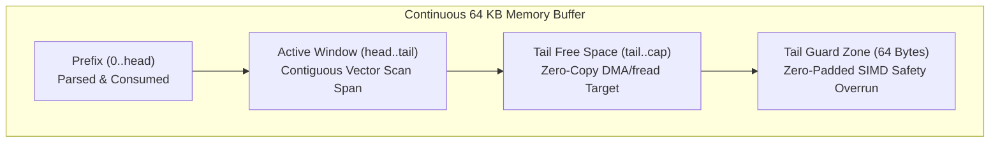
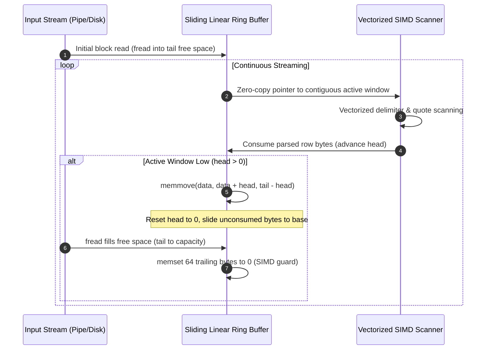
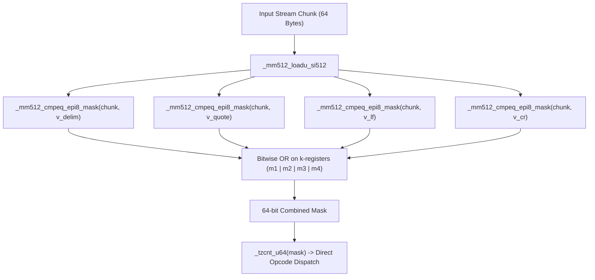
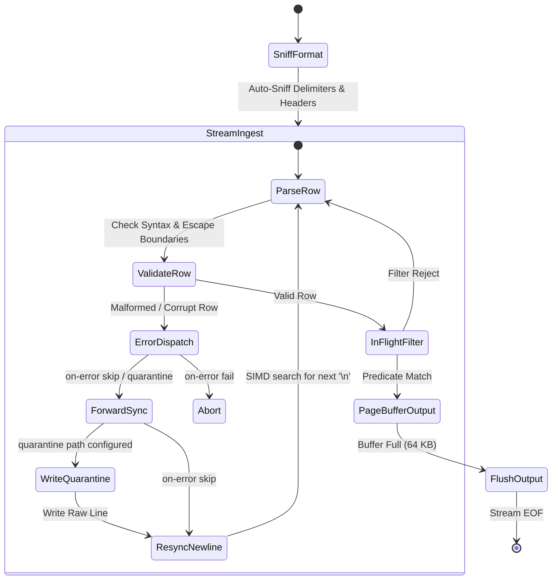
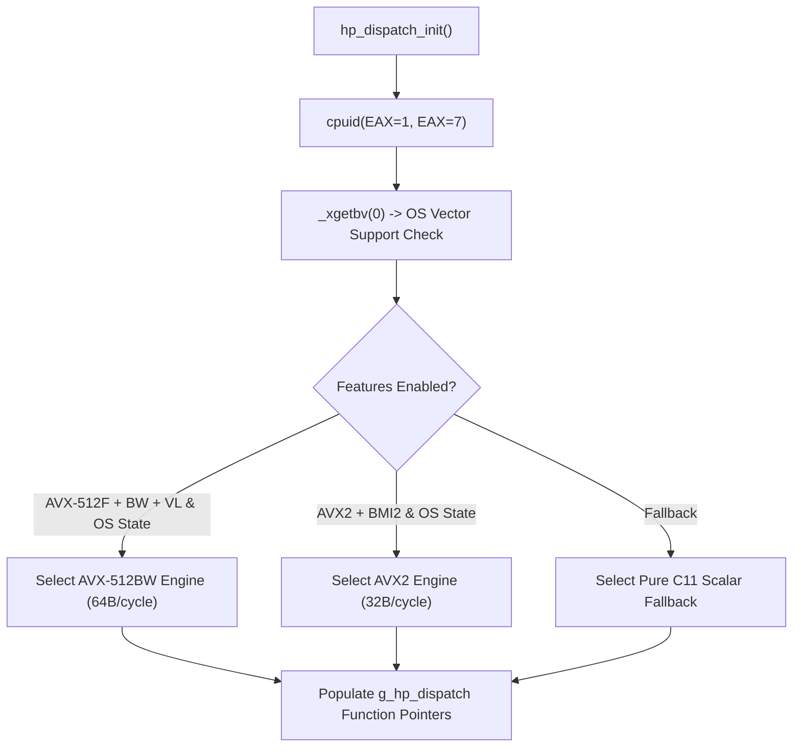

# HyperPipe Architecture & Systems Specification

## 1. Overview
HyperPipe is a bounded $O(1)$ memory streaming structured data transcoder and in-flight projection/filtering engine written in pure ISO C11 with dynamic runtime vector acceleration (AVX-512BW/VL, AVX2, BMI2, and scalar fallback).

---

## 2. Sliding Linear Ring Buffer ($O(1)$ RSS Guarantee)

Traditional circular buffers suffer from non-contiguous wrap-around boundaries that break SIMD vector loads, forcing branchy split-register handling. HyperPipe solves this using a **Sliding Linear Window with Zero-Copy Vector Padding**:



### Sliding Window Lifecycle (Zero Allocation)



---

## 3. Vectorized CSV Scanner State Machine

### AVX2 Scanner Pipeline (32 Bytes / Cycle)

```mermaid
flowchart TD
    In["Input Stream Chunk (32 Bytes)"] --> Load["_mm256_loadu_si256"]
    
    Load --> CmpDelim["_mm256_cmpeq_epi8(',')"]
    Load --> CmpQuote["_mm256_cmpeq_epi8('\"')"]
    Load --> CmpLF["_mm256_cmpeq_epi8('\\n')"]
    Load --> CmpCR["_mm256_cmpeq_epi8('\\r')"]
    
    CmpDelim --> OrAll["_mm256_or_si256"]
    CmpQuote --> OrAll
    CmpLF --> OrAll
    CmpCR --> OrAll
    
    OrAll --> Movemask["_mm256_movemask_epi8 (Extract 32-bit Mask)"]
    
    Movemask --> Check{"Mask == 0 ?"}
    Check -- Yes --> Skip["Advance 32 Bytes (Zero Branches)"]
    Check -- No --> CTZ["__builtin_ctz(mask) (Jump Directly to Delimiter)"]
```

### AVX-512BW Scanner Pipeline (64 Bytes / Cycle)

Zen 4 and modern Xeon architectures execute 64-byte vector comparisons returning native `__mmask64` registers:



---

## 4. Fault-Tolerant Streaming State Machine



---

## 5. Dynamic Runtime CPUID Dispatch

CPU capabilities are detected once at process initialization:


