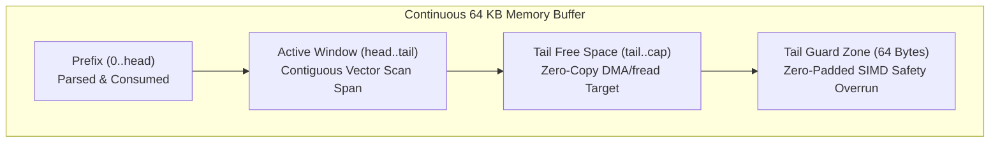
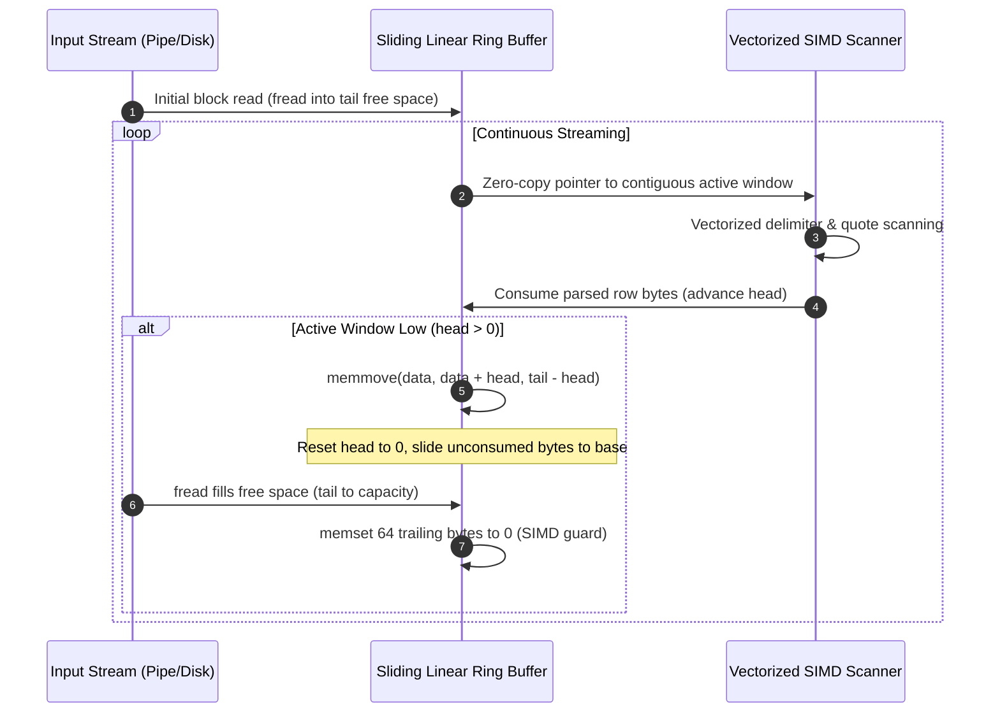
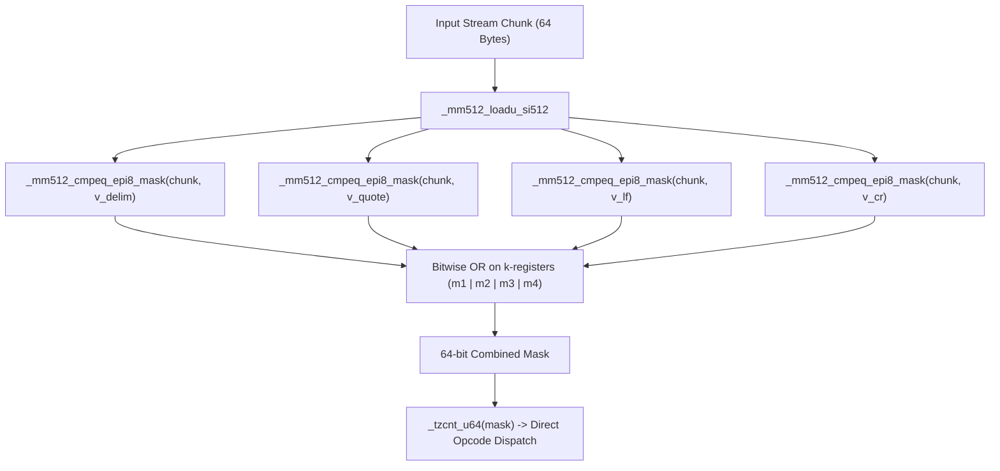
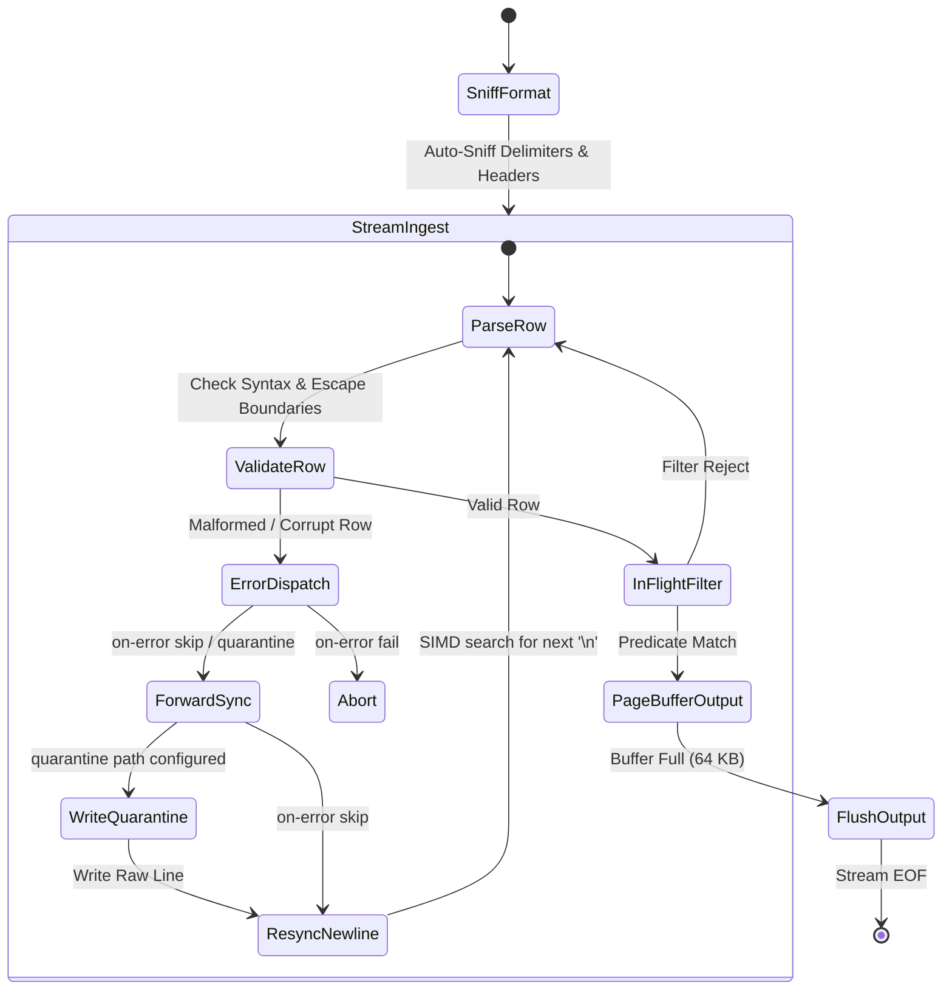
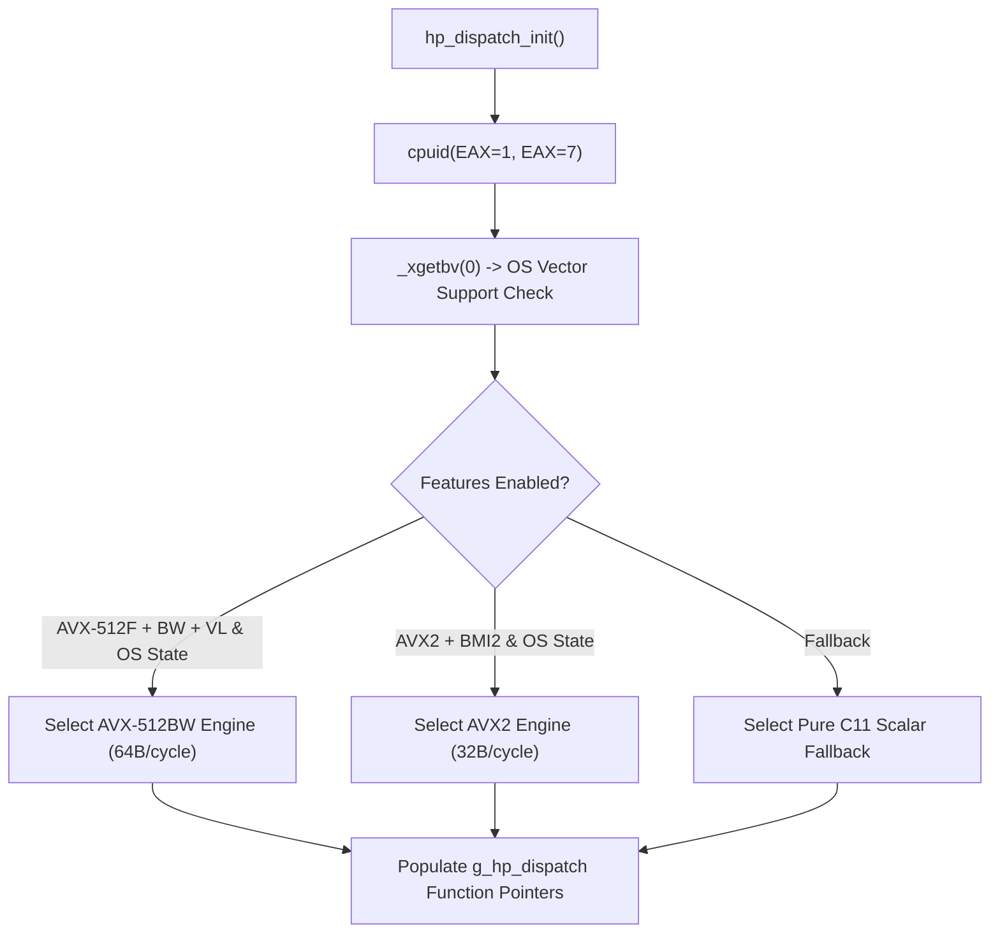

# HyperPipe Architecture & Systems Specification

## 1. Overview
HyperPipe is a bounded $O(1)$ memory streaming structured data transcoder and in-flight projection/filtering engine written in pure ISO C11 with dynamic runtime vector acceleration (AVX-512BW/VL, AVX2, BMI2, and scalar fallback).

### Design rules (v1.4)
1. **Two behaviors, not two implementations of everything.** Quote-free rows
   (the overwhelming majority of machine-generated data) take the SIMD chunk
   loop; any quote in a row hands the WHOLE row to the scalar RFC 4180 state
   machine. One scalar implementation owns all quoting edge cases, so SIMD
   and scalar can never disagree on quoted-field semantics.
2. **Zero-copy row references.** Serialization reads parsed rows in place;
   only projections materialize a (partial) copy. No 24 KB row struct ever
   moves per row on the hot path.
3. **Memoize per-header work, not per-row work.** JSON key fragments are
   built once per header and re-used for every row.

---

## 2. Sliding Linear Ring Buffer ($O(1)$ RSS Guarantee)

Traditional circular buffers suffer from non-contiguous wrap-around boundaries that break SIMD vector loads, forcing branchy split-register handling. HyperPipe solves this using a **Sliding Linear Window with Zero-Copy Vector Padding**:



### Sliding Window Lifecycle (Zero Allocation)



---

## 3. Vectorized CSV Row Parsers (v1.3 chunk-loop design)

Both vector engines (`hp_csv_parse_row_avx512`, `hp_csv_parse_row_avx2`) run
the same three-phase algorithm, differing only in vector width (64 vs 32
bytes per chunk):

1. **Chunk loop.** Load the next full vector. If any byte is `"` -> discard
   partial fields and defer the whole row to the scalar parser (rule 1
   above). Otherwise extract the delimiter mask and the CR/LF mask:
   - no CR/LF -> pop every delimiter from the mask (`tzcnt` loop), emit
     zero-copy fields, advance one chunk;
   - CR/LF found -> pop delimiters before it, emit the trailing field,
     report `consumed` (CRLF-aware) and return.
2. **Byte-wise tail** for the final <64/<32 bytes, same rules.
3. **Buffer-end protocol.** No terminator before the buffer ends:
   if not EOF, return `consumed = 0` and let the caller refill (the caller
   re-parses from scratch); at EOF, emit the trailing (possibly empty) field
   exactly like the scalar parser, so `a,b,<EOF>` yields three fields on
   every engine.

Invariant guarded on every emit: `field_count < HP_MAX_COLUMNS` (a 64 KB
comma-line would otherwise overflow the row struct on ANY engine).

### AVX2 Scanner Pipeline (32 Bytes / Cycle)

```mermaid
flowchart TD
    In["Input Stream Chunk (32 Bytes)"] --> Load["_mm256_loadu_si256"]
    
    Load --> CmpDelim["_mm256_cmpeq_epi8(',')"]
    Load --> CmpQuote["_mm256_cmpeq_epi8('\"')"]
    Load --> CmpLF["_mm256_cmpeq_epi8('\\n')"]
    Load --> CmpCR["_mm256_cmpeq_epi8('\\r')"]
    
    CmpDelim --> OrAll["_mm256_or_si256"]
    CmpQuote --> OrAll
    CmpLF --> OrAll
    CmpCR --> OrAll
    
    OrAll --> Movemask["_mm256_movemask_epi8 (Extract 32-bit Mask)"]
    
    Movemask --> Check{"Mask == 0 ?"}
    Check -- Yes --> Skip["Advance 32 Bytes (Zero Branches)"]
    Check -- No --> CTZ["__builtin_ctz(mask) (Jump Directly to Delimiter)"]
```

### AVX-512BW Scanner Pipeline (64 Bytes / Cycle)

Zen 4 and modern Xeon architectures execute 64-byte vector comparisons returning native `__mmask64` registers:



---

## 4. Fault-Tolerant Streaming State Machine



---

## 5. Dynamic Runtime CPUID Dispatch

CPU capabilities are detected once at process initialization:



---

## 6. JSON Serializer: Key-Fragment Cache & Zero-Copy Rows

`hp_json_ser_row` is the hottest function on the CSV->NDJSON path (v1.2
profile: 87% of run time together with escape scanning). Two v1.3 changes:

```mermaid
flowchart LR
    subgraph PerHeader["Once per header (rare)"]
        Bind["hp_json_ser_bind_keys()"] --> Frag['frag_buf: "host": "timestamp": ... (escaped)']
    end
    subgraph PerRow["Per row (hot)"]
        Frag --> M["1 x memcpy per key"]
        V["value typed emit:<br/>number fast check / true / false / null / escape scan"]
    end
```

- **Key fragments.** Keys were re-emitted per row with `strlen` + two stores.
  They are now pre-escaped once per header (`hp_json_ser_bind_keys`,
  re-invoked whenever the header is created or grows mid-stream) and emitted
  with a single `memcpy`. The fragment table self-invalidates on width
  mismatch, so unbound library users silently get the correct slow path.
- **Zero-copy rows.** The output path passes `&raw_row` (or a projected
  3-field copy) instead of copying the full row struct.
- **Type fast paths.** `is_valid_json_number` rejects string fields with one
  first-byte test before the grammar check; strings of 8 bytes or less are
  escape-checked inline without the indirect scanner call.

## 7. Parallel Chunked Pipeline (`--jobs`, v1.5)

One sequential planning pass finds chunk starts: a newline terminates a
record only when the running quote parity is even (RFC 4180 doubles embedded
quotes, so parity is sound). The scan classifies bytes through the
dispatchable `plan_masks` kernels - newline/quote bitmaps per 64-byte chunk
(AVX-512 / AVX2 / scalar twins, differentially tested) - instead of a
per-byte branch, and stops as soon as every boundary is known (the file tail
belongs to the last worker by construction, so reading it would be pure
overhead). The same pass captures the header row, which workers > 0 receive
as a preset header - their chunks begin exactly at a data-row boundary, so
the state after `hp_bind_stream_header` is identical to the single-stream
path. For NDJSON input the preset is the first line's key order (quote
parity is skipped: a raw newline always ends a line there, matching the
single-stream parser).

Each worker runs the unmodified `hp_transcoder_run` over its byte span:
`span_end` enforcement derives the current row's absolute offset from
`bytes_in - available` (one predictable branch per row when enabled, in
both the CSV and NDJSON loops), and worker output flows through an
`fopencookie` sink into a bounded page queue. Pushing blocks when the
queue exceeds its share of the 64 MiB total output budget (split evenly
between the non-head workers), so total memory stays bounded independent
of input size and job count. The coordinator pops the queues strictly in
chunk order, which reproduces the single-threaded byte stream exactly -
the property `test_parallel` asserts in-process and the release gates
assert end-to-end on the full 102-162 MiB datasets.

Scope decisions: gzip input returns `HP_ERR_UNSUPPORTED` (a compressed
stream has no seekable offsets) and the CLI falls back with a notice.
Parallel NDJSON locks the schema to the first line: a worker's growth
order would depend on which rows it happens to see first, so keys beyond
the first line serialize under their column index - the same rule CSV
output documents (enforced by suppressing the out-header growth when a
preset is bound). A first line the reference parsers reject also degrades
to the single-threaded path, whose fault-tolerance mode owns the record.
Quarantine goes through per-worker part files merged in chunk order. The
dispatch table is mutex-guarded because workers initialize transcoders
concurrently.

## 8. Fused SIMD JSON String Emitter (v1.4)

Classic JSON string escaping scans the value for escapable bytes and then
copies it - two passes over every byte. HyperPipe fuses both into one pass:

- clean 32/64-byte chunks move load -> compare-mask -> store (one store per
  chunk, no memcpy call);
- a chunk containing an escape candidate flushes its clean prefix with one
  masked store (AVX-512) or a scalar copy (AVX2), then expands the single
  special byte;
- all escaping rules live in one always-inline function,
  `hp_json_escape_one()`, shared by scalar, AVX2 and AVX-512 paths - the
  rules cannot drift between kernels.

**Hybrid width policy.** Measured on the reference Xeon, a sustained 512-bit
store stream throttles the core more than the extra width wins back on
short fields (pure-64B emit: -2.4% vs v1.3 on the AVX-512 default path).
Policy: strings under `HP_EMIT_512_THRESHOLD` (192 B) use the 32-byte loop;
only long values take the 64-byte path. Net effect on the reference host:
+10.9% W2 vs v1.3. The threshold is a single documented constant.

## 9. Direct-to-Page NDJSON Serialization (v1.4)

`hp_json_ser_row_direct()` serializes a row straight into the caller's
buffer. The transcoder passes its output page buffer: the hot path writes
with zero intermediate copies. A per-row worst-case bound (every byte -> 
6-byte \u00XX expansion) is checked against the remaining page space; on
overflow the page flushes once and retries, and rows larger than a whole
page fall back to the growable serializer buffer. The bound is exact-safe:
the emit loop can never overrun its destination.

## 10. Runtime-Loaded Compression Layer (v1.4)

`src/hp_gzip.c` resolves zlib through `dlopen("libz.so.1")` /
`LoadLibraryA("zlib1.dll")` on first use. Consequences:

- the zero-dependency property holds: nothing links against zlib, and the
  binary runs unchanged on systems without it;
- gzip input is transparent: `hp_reader_t` sniffs the first two bytes of
  any stream; a gzip magic switches that reader into inflate mode;
- multi-member gzip files decode fully (member switches re-feed the magic
  as synthetic input; leftover staging bytes stay queued untouched);
- gzip output runs at level 1 (Z_BEST_SPEED) - the tool's contract is
  throughput, and level 1 held 6.1x on the reference log;
- failures are explicit: `HP_ERR_GZIP_UNAVAILABLE` is a dedicated error
  code with a dedicated user-facing message.

The zlib `z_stream` is mirrored locally (ABI-stable since 1995), so zlib
headers are not needed at build time.

## 11. Fuzzing & Fidelity Testing (v1.4)

Three layers, all wired into the build:

1. **Differential suite** (existing): Scalar == AVX2 == AVX-512 bit-for-bit
   on fixed fixtures and the full real dataset.
2. **Chaos suite** (`tests/test_chaos.c`): 400 seeded adversarial documents
   per run. Checks kernel differential equality on hostile fields (embedded
   quotes, newlines, control and high bytes) plus full-pipeline value
   fidelity: parse(serialize(parse(x))) == parse(x) with value-level
   fingerprints. Deterministic regression documents pin every fidelity bug
   the fuzzer found as a permanent byte-exact case.
3. **Fuzz harness** (`tests/fuzz_harness.c`): the same invariants as a
   libFuzzer entry point (OSS-Fuzz ready) and a standalone ASan+UBSan
   mutation driver (`make fuzz`, 20k iterations by default, plain gcc).
   `make fuzz-long` scales the budget for release gates (the v1.5 gate ran
   200k mutations over the 10-seed in-repo corpus and found the
   unterminated-quoted-EOF fidelity bug fixed in the same release);
   `make coverage` reports gcov line coverage over the full suite.

Fidelity contract encoded by the tests: values are sacred; quoting is
canonicalized on output per RFC 4180 content rules (a quoted-origin field
always travels the re-quoting write path, including the lenient EOF tail
of an unterminated quoted field); a typed empty cell (`""`) survives as
`""`; header names are strings (NUL bytes truncate them by design);
ragged CSV rows keep their real width.

## 12. NDJSON Input: Keymap & Structural Scanner (v1.5)

Three layers, each individually measurable (docs/BENCHMARKS.md 2.3):

1. **Zero-copy spans.** The per-line staging copy is gone; the parser
   receives a bounded span into the ring buffer, and fields point into it
   until the row is consumed (the ring head advances once per outer
   iteration). Only strings containing backslash escapes are decoded into
   the 64 KiB arena.
2. **`hp_keymap`.** Open addressing over the running header: FNV-1a for
   keys over 8 bytes, one multiply-high hash off a packed 8-byte load for
   the (dominant) short keys, with length + packed-bytes confirmation that
   avoids touching header memory. Schema growth inserts through the same
   table; rehashing re-reads the header, so staleness is impossible.
3. **Structural fast path.** One masked vector pass per 64-byte chunk
   yields quote and backslash bitmaps; the walker resolves keys and
   string values as span arithmetic between structural quotes. It aborts
   to the byte-span scanner on any irregularity (backslash anywhere,
   unknown key, unexpected byte) *before* mutating header or keymap state,
   and field assignments are re-reset on fallback - so the general path
   remains the single source of semantic truth and bit-exactness is
   testable by construction.

## 13. `--summary` and `--schema` (v1.5)

**`--summary`** folds each matching row into a per-column accumulator
(`hp_summary_t`, O(columns) memory): inferred type (int / number / string /
mixed), present/empty/absent counts, numeric min/max/mean and lexicographic
string bounds. Numeric state upgrades monotonically (int → number →
mixed), so one streaming pass suffices and no row pointers are retained.
The table prints after the (empty) row stream; the mode refuses `-o`,
`--gzip` and `--count` because the table is the run's only output.

**`--schema <file>`** loads declared column types (`name,type` lines, `#`
comments) and binds them by resolved column name once the header is known.
A column declared `int` takes a fast int64 span parse in numeric filter
predicates - no per-row grammar validation - while fractional literals
still compare correctly against it. The declaration also documents the
data contract next to the pipeline that uses it.
