# HyperPipe Benchmark & Datacenter Stress Scaling Report

## 1. Hardware Specification
- **Host CPU**: AMD Ryzen 5 7600X (Zen 4, 6 Physical Cores / 12 Hardware Threads, 4.7 GHz base / up to 5.3 GHz boost, 32 MB L3 Cache)
- **Motherboard**: MSI X870 GAMING PLUS WIFI (MS-7E47, AMD X870 Chipset)
- **Memory**: 32 GB DDR5 (2x 16 GB Kingston FURY Beast, `KF556C36-16`)
  - Topology: Dual-Channel (DIMMA2 + DIMMB2, 128-bit bus)
  - Speed: 6400 MT/s (DDR5-6400)
  - Theoretical Bandwidth: 102.4 GB/s
- **Vector Extensions**: AVX-512F, AVX-512BW, AVX-512DQ, AVX-512VL, AVX-512CD, AVX-512VPOPCNTDQ, AVX2, BMI2
- **Operating System**: Microsoft Windows 11 Pro x86_64
- **Compiler**: MinGW-W64 GCC 16.2.0 (`-O3 -march=native -flto`)
- **Benchmark Workload**: In-stream predicate filtering (`status == 200`) and field projection (`host,status,bytes`) on authentic server access log datasets.

---

## 2. Benchmark Results

```mermaid
flowchart LR
    subgraph SmallScale["Small Tier (5K rows / 0.5 MB)"]
        direction TB
        S_HP["HyperPipe (CSV): 35.6 MiB/s (0.014 s, 5.50 MB)"]
        S_AWK["GNU awk: 16.8 MiB/s (0.029 s, 10.22 MB)"]
        S_PERL["Perl: 17.8 MiB/s (0.028 s, 9.68 MB)"]
        S_PY["Python: 13.8 MiB/s (0.036 s, 12.28 MB)"]
    end

    subgraph MediumScale["Medium Tier (1.89M rows / 183 MB)"]
        direction TB
        M_HP["HyperPipe (CSV): 1,591.8 MiB/s (0.115 s, 5.51 MB)"]
        M_PERL["Perl: 171.6 MiB/s (1.067 s, 9.69 MB)"]
        M_AWK["GNU awk: 146.0 MiB/s (1.255 s, 10.22 MB)"]
        M_PY["Python: 108.5 MiB/s (1.689 s, 12.35 MB)"]
    end

    subgraph DatacenterScale["Datacenter Tier (51.07M rows / 5.18 GB)"]
        direction TB
        D_HP_WARM["HyperPipe (Warm): 1,848.9 MiB/s (2.675 s, 5.52 MB)"]
        D_HP["HyperPipe (Cold): 1,403.8 MiB/s (3.523 s, 5.51 MB)"]
        D_PERL["Perl: 166.1 MiB/s (29.77 s, 9.66 MB)"]
        D_AWK["GNU awk: 146.4 MiB/s (33.78 s, 10.21 MB)"]
        D_PY["Python: 109.8 MiB/s (45.04 s, 12.34 MB)"]
    end

    SmallScale --> MediumScale --> DatacenterScale
```

### Small Scale (5,000 rows / 0.49 MiB)

| Tool | Elapsed Time | Throughput | Row Rate | Peak RSS RAM | Speed Difference | Memory Difference |
|:---|:---:|:---:|:---:|:---:|:---:|:---:|
| **HyperPipe (AVX-512 -> CSV)** | **0.014 s** | **35.61 MiB/s** | **0.361 Mrows/s** | **5.50 MB** | **1.0x (baseline)** | **1.0x (baseline)** |
| **HyperPipe (AVX-512 -> NDJSON)** | 0.014 s | 36.15 MiB/s | 0.366 Mrows/s | 5.50 MB | 0.99x | 1.0x |
| **Perl 5.38** | 0.028 s | 17.75 MiB/s | 0.180 Mrows/s | 9.68 MB | 2.0x slower | 1.76x more RAM |
| **GNU awk 5.0** | 0.029 s | 16.84 MiB/s | 0.171 Mrows/s | 10.22 MB | 2.1x slower | 1.86x more RAM |
| **Python 3.15 (csv)** | 0.036 s | 13.83 MiB/s | 0.140 Mrows/s | 12.28 MB | 2.6x slower | 2.23x more RAM |

---

### Medium Scale (1,891,714 rows / 183.18 MiB)

| Tool | Elapsed Time | Throughput | Row Rate | Peak RSS RAM | Speed Difference | Memory Difference |
|:---|:---:|:---:|:---:|:---:|:---:|:---:|
| **HyperPipe (AVX-512 -> CSV)** | **0.115 s** | **1,591.80 MiB/s** | **16.439 Mrows/s** | **5.51 MB** | **1.0x (baseline)** | **1.0x (baseline)** |
| **HyperPipe (AVX-512 -> NDJSON)** | 0.206 s | 888.06 MiB/s | 9.171 Mrows/s | 5.51 MB | 1.79x | 1.0x |
| **Perl 5.38** | 1.067 s | 171.62 MiB/s | 1.772 Mrows/s | 9.69 MB | 9.3x slower | 1.76x more RAM |
| **GNU awk 5.0** | 1.255 s | 145.97 MiB/s | 1.508 Mrows/s | 10.22 MB | 10.9x slower | 1.85x more RAM |
| **Python 3.15 (csv)** | 1.689 s | 108.48 MiB/s | 1.120 Mrows/s | 12.35 MB | 14.7x slower | 2.24x more RAM |

---

### Datacenter Scale (51,076,278 rows / 4,945.81 MiB / ~5.18 GB)

| Tool | Elapsed Time | Throughput | Row Rate | Peak RSS RAM | Speed Difference | Memory Difference |
|:---|:---:|:---:|:---:|:---:|:---:|:---:|
| **HyperPipe (AVX-512 -> CSV, Warm)** | **2.675 s** | **1,848.87 MiB/s** | **19.094 Mrows/s** | **5.52 MB** | **1.0x (baseline)** | **1.0x (baseline)** |
| **HyperPipe (AVX-512 -> CSV, Cold)** | 3.523 s | 1,403.77 MiB/s | 14.497 Mrows/s | 5.51 MB | 1.32x | 1.0x |
| **HyperPipe (AVX-512 -> NDJSON)** | 5.691 s | 869.11 MiB/s | 8.975 Mrows/s | 5.51 MB | 2.13x | 1.0x |
| **Perl 5.38** | 29.774 s | 166.11 MiB/s | 1.715 Mrows/s | 9.66 MB | 11.1x slower | 1.75x more RAM |
| **GNU awk 5.0** | 33.780 s | 146.41 MiB/s | 1.512 Mrows/s | 10.21 MB | 12.6x slower | 1.85x more RAM |
| **Python 3.15 (csv)** | 45.040 s | 109.81 MiB/s | 1.134 Mrows/s | 12.34 MB | 16.8x slower | 2.24x more RAM |

---

## 3. Implementation Details

1. **Multi-Chunk Bitmask Row Vectorization**:
   - Lines up to 192 bytes are analyzed via 64-byte AVX-512 vector chunks (`_mm512_loadu_si512`).
   - Structural delimiters and record terminators are isolated into 64-bit mask registers (`_mm512_cmpeq_epi8_mask`).
   - Field offsets and lengths are extracted via trailing zero count (`__builtin_ctzll` / `TZCNT`) and bit clearing (`delims &= delims - 1` / `BLSR`), avoiding scalar byte loops and repeated SIMD reloads.
   - Field count indices are maintained in CPU registers during parsing to prevent redundant stack spills.

2. **Inlined Fast-Path Filtering and Hoisted Dispatch**:
   - Single-equality integer and string predicates (`status == 200`) evaluate via zero-overhead inline memory comparisons directly against field pointers.
   - Dispatch function pointers (`parse_row_fn`), projection column indices, and output delimiters are hoisted outside the ingestion loops, avoiding per-row branch evaluation.
   - Ring buffer head updates are deferred across the entire contiguous block, eliminating 51 million per-row cursor modifications.

3. **Strict Memory Bounding ($O(1)$ Footprint)**:
   - Dynamic buffer allocation is fixed at 512 KiB for the input ring buffer and 64 KiB for the output page buffer.
   - Working set memory (Peak RSS) remains invariant at **5.50 - 5.52 MB** across all input scales from 0.5 MB to 5.18 GB (51+ million rows), achieving lower memory consumption than standard UNIX utilities while processing at near-memory-bus throughput.
