# HyperPipe Benchmark & Datacenter Stress Scaling Report

## 1. Hardware Specification
- **Host CPU**: AMD Ryzen 5 7600X (Zen 4, 6 Physical Cores / 12 Hardware Threads, 4.7 GHz base / up to 5.3 GHz boost, 32 MB L3 Cache)
- **Motherboard**: MSI X870 GAMING PLUS WIFI (MS-7E47, AMD X870 Chipset)
- **Memory**: 32 GB DDR5 (2x 16 GB Kingston FURY Beast, `KF556C36-16`)
  - Topology: Dual-Channel (DIMMA2 + DIMMB2, 128-bit bus)
  - Speed: 6400 MT/s (DDR5-6400)
  - Theoretical Bandwidth: 102.4 GB/s
- **Vector Extensions**: AVX-512F, AVX-512BW, AVX-512DQ, AVX-512VL, AVX2, BMI2
- **Operating System**: Microsoft Windows 11 Pro x86_64
- **Compiler**: MinGW-W64 GCC 16.2.0 (`-O3 -mavx2 -mavx512f -mavx512bw -mavx512vl`)
- **Benchmark Workload**: In-stream predicate filtering (`status == 200`) and field projection (`host,status,bytes`) on authentic server access log datasets.

---

## 2. Benchmark Results

```mermaid
flowchart LR
    subgraph SmallScale["Small Tier (5K rows / 0.5 MB)"]
        direction TB
        S_HP["HyperPipe: 34.2 MiB/s (0.014 s, 5.26 MB)"]
        S_AWK["GNU awk: 17.5 MiB/s (0.028 s, 10.22 MB)"]
        S_PERL["Perl: 16.6 MiB/s (0.030 s, 9.66 MB)"]
        S_PY["Python: 13.9 MiB/s (0.036 s, 12.32 MB)"]
    end

    subgraph MediumScale["Medium Tier (1.89M rows / 183 MB)"]
        direction TB
        M_HP["HyperPipe: 1,286.8 MiB/s (0.142 s, 5.27 MB)"]
        M_PERL["Perl: 161.1 MiB/s (1.137 s, 9.66 MB)"]
        M_AWK["GNU awk: 150.3 MiB/s (1.219 s, 10.21 MB)"]
        M_PY["Python: 110.7 MiB/s (1.655 s, 12.34 MB)"]
    end

    subgraph DatacenterScale["Datacenter Tier (51.07M rows / 5.18 GB)"]
        direction TB
        D_HP["HyperPipe: 1,531.2 MiB/s (3.230 s, 5.26 MB)"]
        D_PERL["Perl: 150.8 MiB/s (32.80 s, 9.66 MB)"]
        D_AWK["GNU awk: 133.4 MiB/s (37.08 s, 10.20 MB)"]
        D_PY["Python: 94.4 MiB/s (52.42 s, 12.34 MB)"]
    end

    SmallScale --> MediumScale --> DatacenterScale
```

### Small Scale (5,000 rows / 0.49 MiB)

| Tool | Elapsed Time | Throughput | Row Rate | Peak RSS RAM | Speed Difference | Memory Difference |
|:---|:---:|:---:|:---:|:---:|:---:|:---:|
| **HyperPipe (AVX-512)** | **0.014 s** | **34.15 MiB/s** | **0.346 Mrows/s** | **5.26 MB** | **1.0x (baseline)** | **1.0x (baseline)** |
| **GNU awk 5.0** | 0.028 s | 17.51 MiB/s | 0.177 Mrows/s | 10.22 MB | 2.0x slower | 1.94x more RAM |
| **Perl 5.38** | 0.030 s | 16.58 MiB/s | 0.168 Mrows/s | 9.66 MB | 2.1x slower | 1.84x more RAM |
| **Python 3.15 (csv)** | 0.036 s | 13.90 MiB/s | 0.141 Mrows/s | 12.32 MB | 2.6x slower | 2.34x more RAM |

---

### Medium Scale (1,891,714 rows / 183.18 MiB)

| Tool | Elapsed Time | Throughput | Row Rate | Peak RSS RAM | Speed Difference | Memory Difference |
|:---|:---:|:---:|:---:|:---:|:---:|:---:|
| **HyperPipe (AVX-512)** | **0.142 s** | **1,286.84 MiB/s** | **13.289 Mrows/s** | **5.27 MB** | **1.0x (baseline)** | **1.0x (baseline)** |
| **Perl 5.38** | 1.137 s | 161.12 MiB/s | 1.664 Mrows/s | 9.66 MB | 8.0x slower | 1.83x more RAM |
| **GNU awk 5.0** | 1.219 s | 150.27 MiB/s | 1.552 Mrows/s | 10.21 MB | 8.6x slower | 1.94x more RAM |
| **Python 3.15 (csv)** | 1.655 s | 110.71 MiB/s | 1.143 Mrows/s | 12.34 MB | 11.7x slower | 2.34x more RAM |

---

### Datacenter Scale (51,076,278 rows / 4,945.81 MiB / ~5.18 GB)

| Tool | Elapsed Time | Throughput | Row Rate | Peak RSS RAM | Speed Difference | Memory Difference |
|:---|:---:|:---:|:---:|:---:|:---:|:---:|
| **HyperPipe (AVX-512)** | **3.230 s** | **1,531.24 MiB/s** | **15.813 Mrows/s** | **5.26 MB** | **1.0x (baseline)** | **1.0x (baseline)** |
| **Perl 5.38** | 32.797 s | 150.80 MiB/s | 1.557 Mrows/s | 9.66 MB | 10.1x slower | 1.84x more RAM |
| **GNU awk 5.0** | 37.080 s | 133.38 MiB/s | 1.377 Mrows/s | 10.20 MB | 11.5x slower | 1.94x more RAM |
| **Python 3.15 (csv)** | 52.415 s | 94.36 MiB/s | 0.974 Mrows/s | 12.34 MB | 16.2x slower | 2.35x more RAM |

---

## 3. Implementation Details

1. **Multi-Chunk Bitmask Row Vectorization**:
   - Lines up to 192 bytes are analyzed via 64-byte AVX-512 vector chunks (`_mm512_loadu_si512`).
   - Structural delimiters and record terminators are isolated into 64-bit mask registers (`_mm512_cmpeq_epi8_mask`).
   - Field offsets and lengths are extracted via trailing zero count (`__builtin_ctzll`) and bit clearing (`delims &= delims - 1`), eliminating scalar byte loops and repeated SIMD reloads.
2. **Zero-Copy Inlined Fast-Path Filtering**:
   - Integer predicate comparisons (`status == 200`) use an inlined 64-bit digit accumulator reading directly from field memory without calling `strtod()` or allocating intermediate stack strings.
3. **Bounded Memory Profile ($O(1)$ Footprint)**:
   - Dynamic buffer sizing is configured at 256 KiB for the input ring buffer and 64 KiB for the output page buffer.
   - Peak RSS is strictly bounded at 5.26 MB across all input sizes from 0.5 MB to 5.18 GB.
